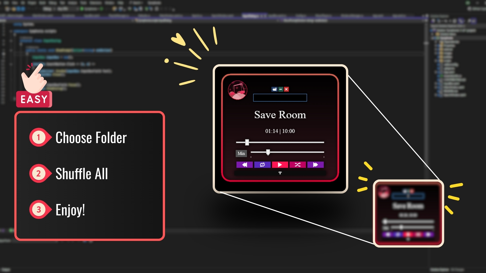

# 🎶 Symphonia



Symphonia is a **Windows XAML-based offline music player**.  
It’s lightweight, simple, and designed for anyone who just wants to play their local music without relying on online services.

⚠️ **Work in Progress** — This project is under active development. Expect frequent updates and breaking changes as it evolves.

---

## ✨ Features (Current & Planned)

- 🎵 Play music stored locally on your computer  
- 📂 Browse and organize tracks  
- ⏯️ Basic playback controls (Play, Pause, Skip)  
- 🌓 Simple and clean UI built with XAML
- 💖 Simple hearting system to favorite songs, making them play more frequently.
- 🚧 Future: themes, and more advanced playback options  

---

## 📦 Installation  

- 🔽 **Option 1:** Download the latest release from the [Releases](../../releases) section and run the `.exe`.  
- 🛠️ **Option 2:** Build it yourself  
  ```bash
  git clone https://github.com/<your-username>/Symphonia.git

---

## 🤝 Contributing

This repo is public so anyone can:  
- Fork it and experiment  
- Suggest improvements via Issues or Pull Requests  
- Use it in your own projects (while respecting the license)

If you’d like to contribute, please branch off and open a pull request into `main`.  
(`main` is protected to keep it clean and stable.)

For details, see [CONTRIBUTING.md](CONTRIBUTING.md).

### 🪄 Committing assistant-provided updates

If you pulled changes generated by this assistant and want to place them on a
new branch in your GitHub repository, you can run the following commands in
your local clone:

```bash
# Make sure you are on the repository root
git checkout -b export-import-favorites

# Inspect the diff to confirm the changes look right
git status
git diff

# Stage and commit the changes
git add .
git commit -m "Add export/import workflow for favorites"

# Push the branch to your GitHub fork or origin
git push -u origin export-import-favorites
```

After the push completes you can open a pull request from the
`export-import-favorites` branch through the GitHub UI.

---

## 🙌 Acknowledgements

- Built with ❤️ using C# and XAML  
- Inspired by the simplicity of old-school offline players
- And really, I just built it because I want a fast one-click-shuffle player for my downloaded music. Thought I'd share it with anyone who might want it.

---

### 🚀 Status: WIP
Symphonia is still in its early stages, but it’s public for anyone who needs a no-frills offline player. Feedback and ideas are welcome!
